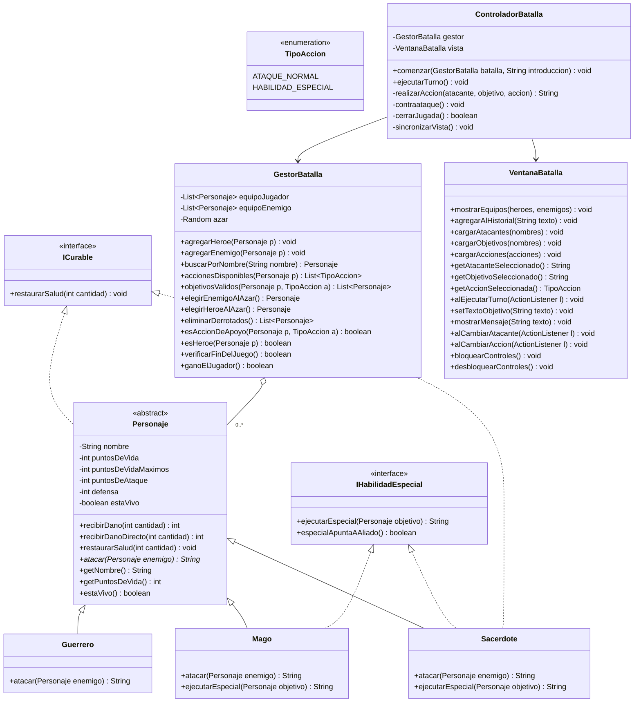
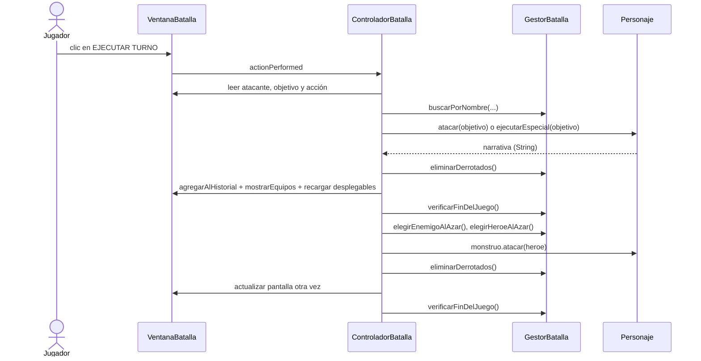

# Diseño de Epic Arena

Borrador para revisar entre los dos **antes** de escribir código.

## Diagrama de clases

La vista se divide por dentro en `PanelEstado` (dos `JTable`), `PanelHistorial`
(`JTextArea` + `JScrollPane`) y `PanelControles` (tres `JComboBox` + botón).

## Flujo de un turno

## Decisiones de diseño

| # | Decisión | Motivo |
|---|---|---|
| 1 | `Personaje` tiene un atributo `defensa` que el enunciado no lista | El Mago "ignora la defensa": sin defensa esa regla no significa nada. `recibirDano` descuenta la defensa; `recibirDanoDirecto` no. |
| 2 | `puntosDeVidaMaximos` como atributo extra | La curación no debe pasar del máximo y la tabla puede mostrar una barra de vida. |
| 3 | El controlador nunca pregunta por la clase concreta | Para el ataque normal llama `atacante.atacar(objetivo)`. Para la especial solo comprueba la capacidad (`IHabilidadEspecial`), no si es Mago o Sacerdote. |
| 4 | `especialApuntaAAliado()` en `IHabilidadEspecial` | La especial del Sacerdote va a un compañero, así que el desplegable de objetivos debe cambiar de equipo sin que nadie pregunte "¿es Sacerdote?". |
| 5 | `GestorBatalla.accionesDisponibles` y `objetivosValidos` | La vista solo ofrece opciones legales, así desaparecen los casos de error en vez de validarlos después. |
| 6 | `Random` se recibe por constructor en `GestorBatalla` | Permite pruebas con semilla fija para el contraataque. |
| 8 | `ControladorBatalla.comenzar(...)` recibe la batalla en vez de crearla | El mismo controlador sirve para encadenar varios combates (campaña) sin cambios. |
| 7 | La vista trabaja con nombres (`String`), el controlador busca el objeto real | Es el paso 3 del enunciado. Exige nombres únicos por partida. |

## Dudas para resolver (algunas con el docente)

1. **Método extra en la interfaz**: `especialApuntaAAliado()` no aparece en el
   enunciado. Si el docente exige la interfaz con un único método, se mueve a
   `Personaje` o al gestor.
2. **Monstruos con especial**: el enunciado solo pide un contraataque normal al
   azar. Que usen su especial a veces sería un extra.
3. **Librerías de apariencia**: el enunciado dice "puramente Java Swing". No se
   usa ninguna externa salvo que el docente lo autorice.
4. **Costo de la especial**: hoy se puede usar en todos los turnos. Un tiempo
   de recarga o maná la haría una decisión táctica (extra opcional).

## Dudas ya resueltas

- **`ICurable`**: `Personaje` implementa `ICurable`, porque para que el
  Sacerdote cure a un compañero ese compañero debe poder recibir
  `restaurarSalud`. El Sacerdote la declara además de forma explícita, como
  pide el enunciado. Así cualquier personaje vivo puede ser curado.
- **Monstruos**: son instancias de las mismas subclases (`Guerrero`, `Mago`,
  `Sacerdote`) con otros nombres y estadísticas. El enunciado habla de
  "Héroes y Villanos" sobre la misma jerarquía, y que la misma clase funcione
  en ambos equipos demuestra el polimorfismo sin clases de relleno.
- **`recibirDano` retorna `int`**: el daño realmente aplicado, para que la
  narrativa muestre la cifra real después de la defensa.
