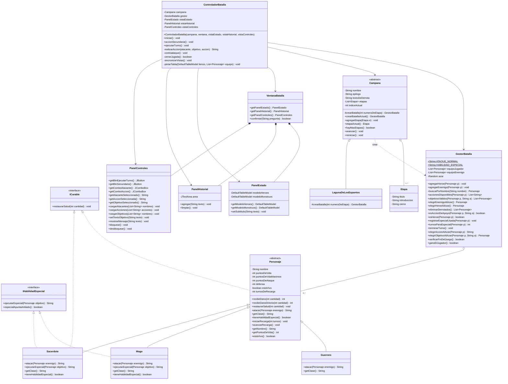
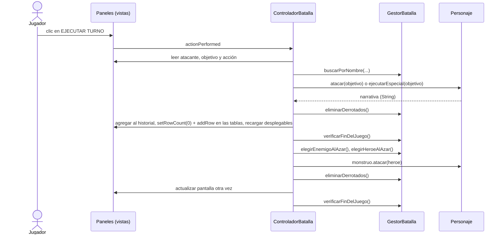

# Diseño de Epic Arena

Borrador para revisar entre los dos **antes** de escribir código.

## Diagrama de clases

La vista son tres paneles: `PanelEstado` (dos `JTable`), `PanelHistorial`
(`JTextArea` + `JScrollPane`) y `PanelControles` (tres `JComboBox` + botón).
`VentanaBatalla` solo los acomoda con `BorderLayout`. El controlador orquestador
recibe los tres, como en el taller de múltiples vistas. Ningún archivo de la
vista importa clases del modelo: el controlador desglosa cada `Personaje` y lo
pinta fila por fila en el `DefaultTableModel`.

## Flujo de un turno

## Decisiones de diseño

| # | Decisión | Motivo |
|---|---|---|
| 1 | `Personaje` tiene un atributo `defensa` que el enunciado no lista | El Mago "ignora la defensa": sin defensa esa regla no significa nada. `recibirDano` descuenta la defensa; `recibirDanoDirecto` no. |
| 2 | `puntosDeVidaMaximos` como atributo extra | La curación no debe pasar del máximo y la tabla muestra la vida como `85 / 120`. |
| 3 | El controlador nunca pregunta por la clase | Para el ataque normal llama `atacante.atacar(objetivo)`. Para la especial llama `tieneHabilidadEspecial()`, que Mago y Sacerdote sobrescriben, y luego hace el cast a `IHabilidadEspecial`. No hay ningún `instanceof` en el proyecto. |
| 4 | `especialApuntaAAliado()` en `IHabilidadEspecial` | La especial del Sacerdote va a un compañero, así que el desplegable de objetivos debe cambiar de equipo sin que nadie pregunte "¿es Sacerdote?". |
| 5 | `GestorBatalla.accionesDisponibles` y `objetivosValidos` | La vista solo ofrece opciones legales, así desaparecen los casos de error en vez de validarlos después. |
| 6 | `Random` se recibe por constructor en `GestorBatalla` | Permite pruebas con semilla fija para el contraataque. |
| 8 | `Main` arma el modelo (`Campana`) y las vistas, y se los pasa al constructor del controlador | Es la forma de los talleres: `XController(modelo, vistas...)`. |
| 9 | La recarga de la especial es un atributo `int` de cada `Personaje`; `GestorBatalla.terminarTurno()` la descuenta en los dos equipos | Deja `IHabilidadEspecial` casi igual al enunciado. Tras usarla hay que esperar 2 turnos. |
| 10 | El modelo decide la jugada del monstruo (`elegirAccionAlAzar`, `elegirObjetivoAlAzar`) | El controlador solo la ejecuta. Ataque normal casi siempre; especial el 30 % de las veces si está lista; quien cura elige al compañero más herido. |
| 11 | `Campana` es abstracta con `crearBatalla(int numeroDeEtapa)`; `LagunaDeLosEspantos` la sobrescribe con un `switch` | Reintentar una etapa perdida la crea de nuevo con todos los personajes intactos. |
| 12 | `Campana` y `Etapa` en el modelo; los textos y estadísticas en el paquete `historia` | El modelo sabe *cómo* avanza una campaña; `LagunaDeLosEspantos` solo arma objetos. Otra historia sería otra clase en `historia`, sin tocar modelo, vista ni controlador. |
| 13 | El controlador lleva un estado en constantes `String` (`EN_BATALLA`, `ETAPA_SUPERADA`, `DERROTA`, `CAMPANA_COMPLETA`) | El botón pequeño hace lo que toca en cada momento: siguiente etapa, reintentar o volver a empezar. |
| 14 | Verbo de ataque y nombre del especial como atributos de cada personaje | Cada espanto narra a su manera ("la Patasola desgarra con sus colmillos") sin crear una subclase por enemigo. |
| 7 | La vista trabaja con nombres (`String`), el controlador busca el objeto real | Es el paso 3 del enunciado. Exige nombres únicos por partida. |
| 15 | Solo se usa lo visto en los talleres | Nada de `enum`, `HashMap`, `Supplier`, `AbstractTableModel` ni renderers propios. Las acciones son las constantes `GestorBatalla.ATAQUE_NORMAL` y `HABILIDAD_ESPECIAL`. |
| 16 | La escena (`PanelEscena`) es una cuarta vista que va sobre el historial | Los cuatro paneles que pide el enunciado siguen intactos; la escena se suma en el centro, junto al historial. |
| 17 | Sprites con `JLabel` + `ImageIcon`, animados con `javax.swing.Timer` | Es lo único que se añade fuera de los talleres, y lo más simple que existe: cada personaje es un `SpriteAnimado` (un `JLabel`) y animar es cambiar su icono cada 110 ms. Nada de `paintComponent` ni dibujo a mano. |
| 18 | Los cuadros vienen ya dibujados: `sprites/personajes/<nombre>/<animación>_<n>.png` | Java no recorta ni escala imágenes. La carpeta sale del nombre del personaje (`SpriteAnimado.archivoDe`: sin artículo, minúsculas, sin tildes), así el modelo no guarda nada visual. |
| 19 | Las animaciones de un turno se encolan y se ven en orden | El modelo resuelve la jugada al instante; la escena muestra ataque, daño y caída uno tras otro. Mientras se ven, el botón "EJECUTAR TURNO" no hace nada. |
| 20 | `Etapa` guarda el nombre de su escenario (`"paramo"`, `"rio"`...) | Es un dato del guion, como el título. La vista busca el fondo con ese nombre. |
| 21 | El prólogo son objetos `EscenaDelPrologo` (texto, escenario, personajes y si los espantos duermen o despiertan) guardados en `Campana` | Es parte de la historia, igual que las etapas. `LagunaDeLosEspantos` arma las cinco escenas; otra historia podría no tener prólogo. |
| 22 | Un segundo controlador, `ControladorPrologo`, que al terminar llama a `ControladorBatalla.iniciar()` | Cada controlador tiene una sola tarea. `Main` arma los dos; la ventana cambia de pantalla con `setContentPane`. |
| 23 | El prólogo reutiliza `PanelEscena` y el texto aparece letra por letra con un `Timer` | No hay animación nueva que mantener: los espantos usan su pose `dormido` y despiertan con su especial. El primer clic en "Siguiente" completa el texto; el segundo pasa de escena. |
| 24 | `Sonido` (en la vista) reproduce música en bucle y efectos con `javax.sound.sampled.Clip`, que viene con Java | Sin librerías externas. Si el equipo no tiene audio, el juego sigue en silencio. Las pruebas corren con `-Depicarena.silencio=true`. Un botón en cada pantalla lo apaga o lo enciende. |
| 25 | Cada animación puede llevar su efecto (`animar(nombre, animacion, efecto)`) | El sonido suena cuando la animación empieza, no cuando el modelo resuelve la jugada, así golpe e imagen van juntos. |
| 26 | `SpriteAnimado` es un `JButton` transparente | Tocar a un personaje se maneja con `ActionListener`, como cualquier botón de los talleres. En la batalla elige atacante u objetivo; en el prólogo cuenta su leyenda. |
| 27 | La escena del prólogo guarda sus interacciones: tunjos por lanzar, efecto al entrar, indicación y lo que dice cada personaje al tocarlo | El guion sigue entero en `LagunaDeLosEspantos`; el controlador solo lo recorre. |
| 28 | El prólogo se ve a ×3 (1440 × 480) si la pantalla mide al menos 1500 × 950; si no, a ×2 | `PanelEscena` recibe la escala y busca las imágenes en `sprites/` (×2) o `sprites/x3/` (×3). Solo lo que sale en el prólogo existe a ×3. Escalar por un número entero mantiene nítido el pixel art. |
| 29 | Práctica guiada después del prólogo: objetos `PasoGuiado` (jugada pedida, por qué y respuesta del enemigo) guardados en `Campana` | El tutorial es parte de la historia. `LagunaDeLosEspantos` arma la batalla de práctica sobrescribiendo `crearBatallaDePractica()`, igual que las etapas. |
| 30 | `ControladorBatalla` tiene un modo práctica en lugar de un tercer controlador | Reutiliza todo el turno (validación, animaciones, tablas, historial). Solo cambian tres cosas: se rechaza la jugada que no pide el paso, la respuesta del enemigo viene del paso y no del azar, y al ganar el botón dice "Comenzar el viaje". |
| 31 | La respuesta del enemigo en la práctica está fijada | Así las cifras de cada explicación ("perderá 26 de sus 40") siempre se cumplen. `PracticaTest` juega el guion sobre el modelo y lo comprueba. |
| 32 | La jugada se arma con clics, sin desplegables ni botón "EJECUTAR TURNO" (decisión del equipo) | Tocar a un héroe muestra su barra de habilidades; los objetivos válidos se marcan bajo los pies (rojo si es para atacar, verde si es para curar) y tocar uno ejecuta el turno. Tocar a un espanto con un héroe elegido lo ataca con el golpe normal. **Se aparta del enunciado**, que pide tres `JComboBox` y el botón rojo. |
| 33 | `ControladorBatalla.jugar(heroe, accion, objetivo)` recibe la jugada por nombres | Es el mismo paso 3 del enunciado (buscar a los personajes reales en el modelo), solo que los nombres llegan de los clics y no de los desplegables. Las pruebas juegan llamando a `tocarPersonaje` o a `jugar`. |
| 34 | Cada personaje describe su ataque y su especial (`describirAtaque`, `getNombreDelEspecial`, `describirEspecial`) | La barra muestra el texto sin preguntar por la clase: cada subclase responde lo suyo (polimorfismo). |
| 35 | Teclado con `InputMap`/`ActionMap` de la ventana (`alPresionar(tecla, oyente)`) | Funciona sin importar qué componente tenga el foco. La ventana reparte cada tecla a los dos controladores y cada uno decide si le toca según la pantalla. Ningún botón toma el foco, para que Espacio y Enter no los activen por su cuenta. |
| 36 | Nombre y barra de vida sobre cada personaje (`FichaEnEscena`: `JLabel` + `JProgressBar` encima del sprite con `OverlayLayout`) | Componentes estándar de Swing, sin dibujar a mano. La altura de la cabeza de cada dibujo viene en `cabeza.txt`. La barra cambia cuando empieza la animación del golpe o la curación, no cuando el modelo resuelve la jugada. En el prólogo solo se ven los nombres. |
| 37 | Interfaz con aspecto de pixel art: fuentes Silkscreen y VT323 (licencia OFL, en `resources/fuentes`) cargadas con `Font.createFont` | Las fuentes son un recurso más, como los sprites: se leen con `getResourceAsStream` y, si fallan, el juego sigue con una fuente del sistema. `Paleta` reúne colores, fuentes y marcos. |
| 38 | Botones como placas dibujadas (`setIcon`, `setRolloverIcon`, `setPressedIcon`, `setDisabledIcon`) con el texto encima | Sin pintar a mano: Swing cambia la imagen sola al pasar el mouse, al presionar o al apagar el botón. La acción elegida usa la placa dorada. Las habilidades muestran nombre y efecto en dos líneas con HTML de Swing. |
| 39 | Marcos con grecas muiscas (`BorderFactory.createMatteBorder` con un ícono que se repite) y la textura de la ventana en un `JLabel` que hace de panel | Bordes y fondo con componentes estándar. La escena queda enmarcada, el historial es un pergamino y el prólogo usa un cuadro de diálogo de piedra. Las flechas de los textos se cambiaron por `»` y "Flechas" porque las fuentes no las traen. |

## Dudas para resolver (algunas con el docente)

1. **Método extra en la interfaz**: `especialApuntaAAliado()` no aparece en el
   enunciado. Si el docente exige la interfaz con un único método, se mueve a
   `Personaje` o al gestor.
2. **Librerías de apariencia**: el enunciado dice "puramente Java Swing". No se
   usa ninguna externa salvo que el docente lo autorice.
3. **Extras frente al enunciado**: recarga de la especial y monstruos que a
   veces la usan. Si el docente quiere el contraataque estrictamente normal,
   basta con que `elegirAccionAlAzar` retorne siempre `ATAQUE_NORMAL`.

## Dudas ya resueltas

- **`ICurable`**: `Personaje` implementa `ICurable`, porque para que el
  Sacerdote cure a un compañero ese compañero debe poder recibir
  `restaurarSalud`. El Sacerdote la declara además de forma explícita, como
  pide el enunciado. Así cualquier personaje vivo puede ser curado.
- **Monstruos**: son instancias de las mismas subclases (`Guerrero`, `Mago`,
  `Sacerdote`) con otros nombres y estadísticas. El enunciado habla de
  "Héroes y Villanos" sobre la misma jerarquía, y que la misma clase funcione
  en ambos equipos demuestra el polimorfismo sin clases de relleno.
- **`recibirDano` retorna `int`**: el daño realmente aplicado, para que la
  narrativa muestre la cifra real después de la defensa.
